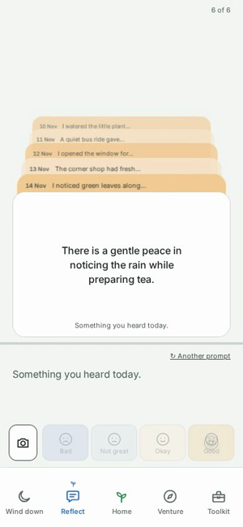
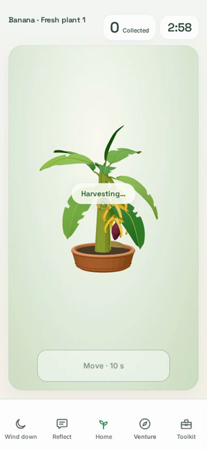
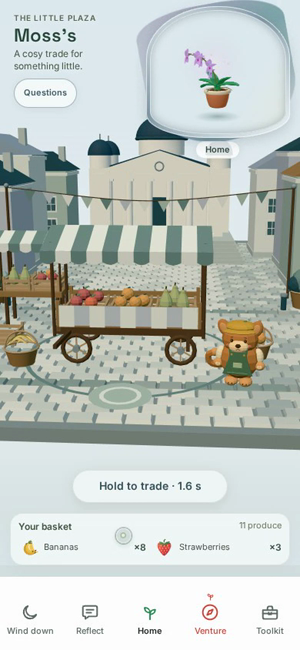

# Garden Ventures

A small, private companion app: a plant you water once a day, a journal card, a three-minute foraging game, a wind-down soundscape and a safety-plan toolkit. Built at Junction 2026 for the "Beyond the Clinic" challenge.

<p align="center">
  
</p>

<p align="center">
  
  
  
</p>

Live demo: https://garden.hopeajahti.lol · [Demo video](https://garden.hopeajahti.lol/models/final.mp4)

## What is in it

- **Home** – hold to water the orchid. It grows over weeks and cannot be killed by missing a day.
- **Reflect** – one prompt a day, written or photographed. A language model writes a short reflection on the back of the card.
- **Venture** – a daily foraging round, limited to three minutes.
- **Wind down** – a local soundscape mixer with a sleep timer.
- **Toolkit** – a safety plan and contacts, stored only on the device.
- **Moss's market** – trade the harvest for ornaments for the plant.

Everything is stored locally in the browser. The only network call is the Reflect reply, which goes through a same-origin proxy (`server/`).

## Run it

```sh
npm install
npm run dev        # the app
npm run server     # optional: the Reflect reply proxy, configured through .env.local
npm run build
npm run check      # browser checks (needs Playwright's Chromium)
```

The reply proxy speaks to any OpenAI-style chat endpoint; see [docs/backend.md](docs/backend.md). Without it the app falls back to a fixed line.

## Documentation

See [docs/](docs/README.md). Garden is a hackathon demo, not a medical device, and makes no clinical claims.

## License

Source available for reading and evaluation; all rights reserved. The bundled track "White Noise and Heartbeat" by canton is CC BY (see `public/audio/SOURCES.md`).
